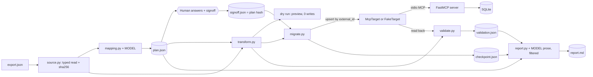

# Architecture (learning view)

Open `architecture.html` in a browser (no network needed; it has no external fonts or scripts). Pick a flow, press Play or the right arrow.
Press `O` to toggle Offline and Live. Click a node to jump to its first step. Drag nodes to move them.
This file says the same thing in text. The project's own design doc is `docs/ARCHITECTURE.md`; this one adds the trust view.

## Components

| Component | File | Job | LLM? |
|---|---|---|---|
| Source reader | `src/migration_agent/source.py:120` | Parse the export with typed models, hash the bytes, collect warnings | No |
| Mapping planner | `mapping.py:151` | Ask a model for a plan, check it, add questions, save `plan.json` | Yes (proposes) |
| Sign-off | `signoff.py:22`, `signoff.py:41` | Save and re-check the approval hash | No |
| Transform | `transform.py:10` | Source records to target values; pure function | No |
| Dry run | `dryrun.py:11` | Preview with the same transform; no writes | No |
| Migrator | `migrate.py:29` | Ordered batches, retry, atomic checkpoint | No |
| Target client | `target.py:63` (`McpTarget`) | FastMCP client over stdio; `TargetError` on `isError` | No |
| Fakes | `fakes.py:24` (`FakeModel`), `fakes.py:53` (`FakeTarget`) | Offline stand-ins | No |
| Target server | `target_server/server.py:29` | Seven typed MCP tools | No |
| Store | `target_server/store.py:27` | SQLite schema, value checks, upserts | No |
| Validator | `validate.py:13` | Counts, required, relations, seeded sample | No |
| Reporter | `report.py:15` | Customer report; model writes prose only, filtered | Yes (prose) |
| Model client | `model.py:35` | LiteLLM wrapper, env-var keys only | (transport) |
| Glue | `cli.py`, `demo.py:26` | Commands and the offline demo | No |

## Data flow

Run order in the code: people, board, card, checklist_item, comment (`migrate.py:54`), so a relation always points at an existing page.

## Where the LLM sits

The model is called in exactly two places: `mapping.plan` (`mapping.py:163`) and `report.report` (`report.py:39`).
Neither call has a tool or a target client. Everything the model returns is untrusted text:

- The plan is parsed by strict pydantic models (`extra="forbid"`, `strict=True`, `mapping.py:23`) and checked against both schemas (`mapping.py:108`).
- A model cannot sign off: `signed_off: true` in a reply is rejected (`mapping.py:166`). Only `signoff()` sets it (`signoff.py:31`).
- Report prose is dropped if it has a number or id-like token that is not in the saved facts (`report.py:31-48`).

## Trust boundaries

1. **Customer data to model**: only counts and up to 3 samples per field leave the code (`mapping.py:72`). The prompt says samples are data, not instructions (`mapping.py:154`). Fixtures are made up; a real customer needs a data-handling decision first (UNVERIFIED for live providers).
2. **Model to code**: JSON schema check, one repair, no file on failure (`mapping.py:162-174`).
3. **Human to code**: the hash of the exact plan bytes (`signoff.py:33`, `signoff.py:45`).
4. **Agent to target**: only MCP tools. The server validates every write again (`store.py:189`). The agent has no direct SQLite access in the real path.
5. **Secrets**: keys come from env vars only (`model.py:39-44`). Errors never print provider text (`model.py:58-60`).
6. **Network**: offline tests block remote sockets (`tests/conftest.py:1`, `tests/test_model.py:65`).

## Offline vs live

| Piece | Offline | Live |
|---|---|---|
| Model | `FakeModel` replays JSON (`fakes.py:24`) | `litellm.completion` to local Qwen or a free hosted model (`model.py:55`) |
| Target | `FakeTarget` calls the same `Store` in-process (`fakes.py:75-81`) | `McpTarget` starts `python -m migration_agent.target_server` over stdio (`target.py:82`) |
| Keys | none | env var per provider |
| Tests | all 167 | `@pytest.mark.live`, opt in |

The same `Target` interface (`target.py:28`) and the same contract test (`tests/test_target_contract.py:14`) cover both targets. See deep-03.

## Run files

All under the runs folder: `plan.json` (mapping + questions + answers), `signoff.json` (`plan_hash`, `signed_by`, `signed_at`),
`checkpoint.json` (`plan_hash`, `batch_size`, per-entity progress), `validation.json` (four checks, seed, sample), `report.md`.
In the demo the target is `fake-target.sqlite`.

## Reading the diagram

The five tabs map to the pipeline: Plan, Sign-off, Dry run, Migrate, Validate and report. Wire colors follow the legend.
"FakeTarget / FastMCP server" is one node whose label changes with the mode, because it is one interface with two implementations.
