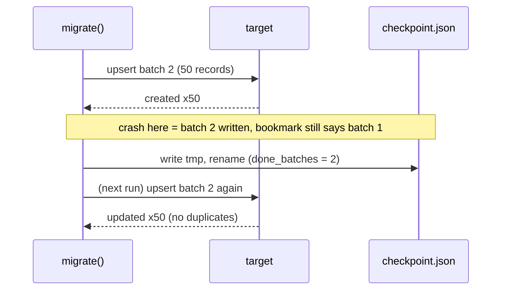

# deep-02: Idempotent upserts and resumable batches

Goes under `lessons/05_batches.py` (the forced crash). That lesson shows *that* replay works. This one shows *why*, and where it stops working.

## Problem

A migration of 10,000 records fails at record 6,300. Or the laptop sleeps between "write to target" and "save progress".
You must continue without duplicates and without starting over.

## Concept (eli5)

Two ideas work together.

1. **Idempotent write.** "Put card-7 here" twice gives one card-7. Like a locker with a number on it: you cannot get two lockers by asking twice.
2. **Checkpoint.** A bookmark in a book. Move it only after you finish the page. If you lose it, you reread one page, not the book.



## Design decisions and alternatives

| Decision | Where | Why | Not picked |
|---|---|---|---|
| Key = source `external_id` (D-005) | `store.py:54`, `store.py:68` `UNIQUE (db, external_id)` | Stable, supplied by the source, usable in relations | Autoincrement ids; exactly-once transaction log |
| Upsert in SQL (`ON CONFLICT DO UPDATE ... WHERE value != excluded.value`) | `store.py:229-231` | One statement, no read-modify-write race; unchanged value is not rewritten | Select then insert/update in app code |
| Validate before the transaction | `store.py:189-212` | A bad record cannot erase good data | Validate inside the write |
| One transaction per record (`with self.connection`) | `store.py:213` | Atomic per page | Per batch (a failure rolls back good records) |
| Checkpoint after a whole batch | `migrate.py:91-94` | Simple; replay cost is one batch | Per record |
| Atomic checkpoint file (tmp + rename) | `migrate.py:20-26` | A crash never leaves half a JSON file (D-009) | Write in place |
| Checkpoint carries `plan_hash` and `batch_size` | `migrate.py:58`, `:64-67` | Different plan or batch size = different batches; refuse | Silently reuse |
| Retry 3 times then stop | `migrate.py:81-90` | Short outages heal; real faults surface | Infinite retry; no retry |
| Parents before children | `migrate.py:54-57` | A relation needs an existing page | Retry relations later |

## Code walkthrough

**Write side: the store.**
`upsert_page` (`store.py:189`) first checks the external id and the value shapes (`store.py:192-194`), then each property name and its group (`values` vs `relations`, `store.py:199-204`), required values (`:209-211`)
and per-type value checks via `_value` (`store.py:153`). Relation ids are resolved to row ids there; an unknown id raises `StoreError` (`store.py:184`).
Only then `with self.connection:` (`store.py:213`) opens a transaction. It finds the page by `(db, external_id)` (`:214-216`), inserts if missing (`:217-221`), deletes values that are no longer sent (`:223-226`), and upserts the rest (`:227-231`).
It returns `"created"` if the page did not exist, else `"updated"` (`:232`).
`upsert_person` does the same for people with one `ON CONFLICT` statement (`store.py:148`).

**Proof the replay changes nothing.** `tests/test_target_server.py:60` writes a page, snapshots all `page_values` rows, replays, and asserts the rows and `connection.total_changes` are unchanged.

**Read side: the runner.**
- `migrate()` first calls `require_signoff` (`migrate.py:32`), validates `batch_size` (`:35`), transforms everything *before the first write* (`:38`). A bad record fails the run before the target is touched.
- It builds jobs in order: people, then board, card, checklist_item, comment (`:41-57`).
- It loads the checkpoint if present and refuses a different plan hash or batch size (`:59-69`), and refuses a malformed progress object (`:70-76`).
- For each job it starts at `done_batches` (`:79`), sends the batch (`:84-86`), retries on `TargetError` (`:88-90`), then updates counts and writes the checkpoint (`:91-94`).

**Why `write_checkpoint` order matters.** The data write is before the checkpoint write. The reverse order would claim progress that never happened and *lose* records. The chosen order can only repeat work.

## Run it

```powershell
.venv/Scripts/python.exe lessons/05_batches.py --fake
```
Expected: `Forced crash: task write has no saved checkpoint`, then `Resume: 2 tasks, no duplicates` (from `lessons/README.md`).

```powershell
.venv/Scripts/python.exe -m pytest tests/test_migrate.py tests/test_target_store.py -q -p no:cacheprovider
```
Expected: `21 passed` (5 + 16, MEASURED test counts per file).

The 120-card test at `tests/test_migrate.py:81` is the strongest proof: crash while saving batch 2, target has 100 pages, checkpoint says 1 batch, resume ends at exactly 120.

## Break it

1. In `migrate.py` move `write_checkpoint(...)` (line 94) above the inner retry loop (before line 81). Run `tests/test_migrate.py`. The crash test should fail or the count should come up short, because progress is claimed before the write. (Predicted, not executed.)
2. In `store.py` remove `UNIQUE (db, external_id)` on `pages` (line 54). `tests/test_target_store.py:69` (`test_external_ids_are_unique_per_database`) should fail. Without the key, replay makes duplicates.
3. In `migrate.py:64` delete the plan hash comparison. `test_guards_before_writes` (`tests/test_migrate.py:106`) should fail at the "plan hash" assertion.

## Where it is NOT safe (read this before an interview)

These come from reading the code. They are not tested here, so treat them as UNVERIFIED limits.

1. **Overwrite on replay.** An upsert replaces the page's values (`store.py:223-231`). If the customer edited the page in the new tool between the crash and the resume, the replay overwrites it. Fix in production: version or `updated_at` compare, or freeze the target during migration.
2. **The report's `created` / `updated` counts can drift.** `counts` resets on each retry attempt (`migrate.py:82`). Records created in a failed attempt count as `updated` in the retry; the same happens after a crash-replay. The totals of pages are right; the created-versus-updated split is not exact. Validation counts (`validate.py:49`) are the source of truth for "how many exist".
3. **Retry has no backoff** (`migrate.py:81-90`) and catches only `TargetError`. A long outage burns 4 quick attempts.
4. **The checkpoint is renamed but not fsynced** (`migrate.py:26`). Atomic against a process crash; durability against power loss is not shown here.
5. **Deletes are not synced.** A record removed from the source after a first run stays in the target.

## Quiz

1. Why write the checkpoint *after* the data? *A crash then repeats work instead of skipping it, and repeated work is harmless.*
2. A batch of 50 fails at record 30 and is retried. Why no duplicates? *Records 1-29 are already keyed by external id; the retry updates them.*
3. Why does the checkpoint store the plan hash? *A changed plan could map the same batch index to different records. Reusing progress would skip or double-write.*

## Interview angle

"Design a resumable bulk import." Say: stable idempotency key, per-batch bookmark written after the data, atomic bookmark file,
bookmark bound to the config hash, bounded retry, validate afterwards. Then volunteer the limits above: concurrent edits, backoff, fsync, deletes.
