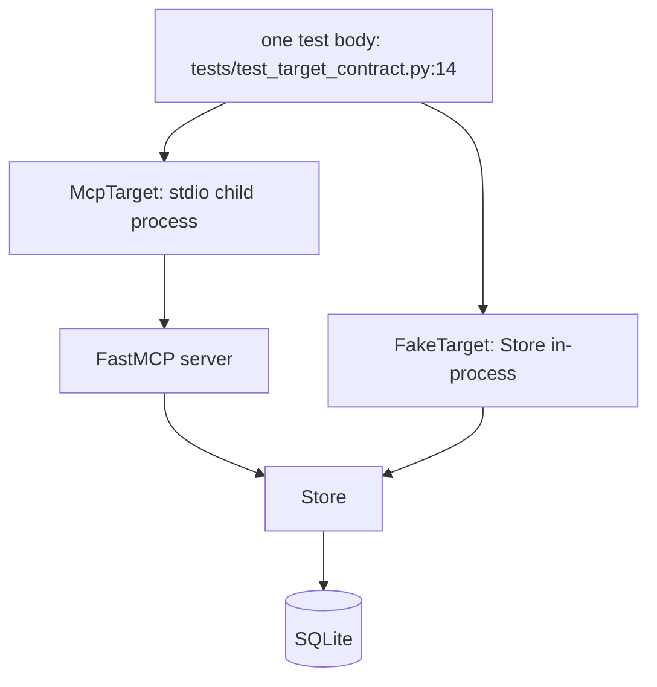

# deep-03: Contract tests with fakes (and a server worth testing)

Goes under `lessons/07_mcp_target_server.md`. That file follows one write into SQLite. This one explains how the project tests the
model and the target without a network, and why the fakes cannot quietly lie.

## Problem

The migration touches two slow, unreliable things: a model and a server. Tests that call them are slow and flaky.
Tests that fake them can pass while the real thing is broken. How do you get fast tests you can trust?

## Concept (eli5)

A fake is a stunt double. The double is only useful if it moves like the actor. A **contract test** makes the actor and the double
run the same scene, with the same checks. If the double fails the scene, the double is wrong.



Both targets end at the same `Store` class. Only the transport differs. So the contract test checks the *transport and error mapping*,
and the store tests check the *rules*.

## Design decisions and alternatives

| Decision | Where | Why | Not picked |
|---|---|---|---|
| One interface, two classes | `target.py:28` `Target`, `McpTarget` `:63`, `FakeTarget` `fakes.py:53` | The migrator never knows which it has | Different method names per class |
| `FakeTarget` wraps the real `Store` | `fakes.py:57-58`, `:79` | Real value checks run offline | A dict-based fake that accepts anything |
| Fake maps `StoreError` to `TargetError` | `fakes.py:80-81` | Same error type as the MCP client (`target.py:103`) | Different exceptions per target |
| `write_calls` counter | `fakes.py:61`, `:76-77` | Lets tests prove "dry run = 0 writes" | Mock call assertions |
| `FakeModel` replays a JSON list | `fakes.py:24-50` | Deterministic prompts to checks; records requests | Patch the HTTP layer everywhere |
| `FakeModel` raises `ScriptExhausted` | `fakes.py:46-47` | A test that asks for an unplanned extra reply fails loudly | Return a default |
| `FakeModel` copies requests | `fakes.py:45` | Later mutation cannot rewrite history (`tests/test_fakes.py:10`) | Store references |
| Socket guard in `conftest.py` | `tests/conftest.py:8-50` | Offline tests cannot silently reach a model | Trust each test |
| Live tests are opt-in | `-m live`; guard skipped when `markexpr == "live"` (`conftest.py:11`) | Default run executes 0 live tests (`tests/test_model.py:80`) | Mixed run |

## Code walkthrough

**The contract test.** `tests/test_target_contract.py:14` is parametrized over `"fake"` and `"mcp"` (`:13`).
For `mcp` it builds `McpTarget(Settings(db_path=tmp_path/"target.sqlite"))`, which starts a real child process.
The body then does the whole life of a target: create two databases, upsert a person twice (`created` then `updated`), upsert a page twice with a relation,
count, `get_page`, paginate (`:35-36`), and finally three bad writes that must raise `TargetError` with a matching message and leave the page unchanged (`:38-43`).

**How errors cross the process boundary.**
1. Store raises `StoreError` (for example `missing required property 'Title'`, `store.py:210`).
2. `server._call` converts it to `ToolError` (`server.py:22-26`), with `from None` so no traceback leaks.
3. FastMCP returns a tool result with `isError`.
4. `McpTarget._call` checks `result.is_error` and raises `TargetError("; ".join(texts))` (`target.py:102-103`).
5. `migrate()` catches `TargetError` for retry (`migrate.py:88`).

The `FakeTarget` shortcut does steps 1 and 4 only (`fakes.py:78-81`). The contract test proves both paths give the same message shape (`match="Title.*title"`).

**Starting a Windows child process.** `McpTarget.__init__` (`target.py:66-83`) resolves the command, swaps `python` for `sys.executable`
so client and server share one environment (`:74-75`), sets `MIGRATION_AGENT_DB_PATH` and `PYTHONPATH` (`:78-81`), and builds a `StdioTransport` with `keep_alive=False` (`:82`).
`tests/test_target_contract.py:53` pins "default command uses this Python"; `:47` pins "missing command names the setting `target_server`".

**Testing the server by itself.** `tests/test_target_server.py` uses FastMCP's in-memory `Client(server)` (no process) for tool names (`:47`), idempotency (`:60`),
error results (`:97`), relations (`:114`) and "bad arguments do not stop the server" (`:135`). One extra test starts the module as a real child over stdio (`:151`).
So: many fast in-memory tests, one slow honest process test.

**The model fake and the plan.** `FakeModel(SCRIPTS / "plan.json")` replays `src/migration_agent/fake_scripts/plan.json`. Tests that need a bad reply pass a list:
`FakeModel([{"text": "{"}, {"text": "{"}])`. `tests/test_mapping.py:60` uses it to prove two bad replies leave no file and exactly 2 requests were made.

**The socket guard.** `pytest_sessionstart` (`conftest.py:8`) patches `socket.connect`, `connect_ex`, `sendto` and `getaddrinfo`; any non-loopback host raises
`OSError("offline tests block non-loopback sockets")` (`conftest.py:24`). Loopback is allowed because the stdio MCP test and local servers need it.
`tests/test_model.py:65` proves the guard blocks `192.0.2.1`, a DNS lookup and UDP, and allows `127.0.0.1`.

## Run it

```powershell
.venv/Scripts/python.exe -m pytest tests/test_target_contract.py tests/test_target_server.py tests/test_target_store.py -q -p no:cacheprovider
```
Expected: `31 passed` (5 + 10 + 16, MEASURED per-file counts; matches the number in `lessons/07_mcp_target_server.md`).

## Break it

1. In `fakes.py:80` change `except (StoreError, sqlite3.Error, OSError)` to catch only `sqlite3.Error`. The `fake` case of `test_target_contract` should fail: a `StoreError` escapes instead of `TargetError`. The `mcp` case still passes. That is the point: only the contract test sees the drift. (Predicted, not executed.)
2. In `server.py:25-26` re-raise the original error instead of `ToolError`. The server may still return an error, but the message shape can change; `test_bad_page_returns_error_without_changing_data` (`tests/test_target_server.py:97`) is the one to watch. (Predicted; FastMCP may mask the text, UNVERIFIED which.)
3. Make `FakeModel.chat` return the last reply forever instead of raising at `fakes.py:46`. `test_script_replay_and_request_copy` (`tests/test_fakes.py:10`) should fail on `ScriptExhausted`.

## Quiz

1. Why does `FakeTarget` use the real `Store`? *So the fake enforces the same rules. Only the transport is faked.*
2. What does the contract test catch that the store tests cannot? *Differences in transport, serialization and error mapping between fake and MCP.*
3. Why is one stdio test enough? *It proves the process starts and a call crosses; the rules are already tested faster in-memory.*

## Interview angle

"How do you test code that depends on an LLM and a remote service?" Answer: replay fake for the model (scripted, records requests, fails when exhausted),
a fake service built on the real logic, one contract suite run against both, a network guard so offline means offline, and live tests behind an explicit marker.
Mention the cost: the contract suite starts a process, so it is the slowest part of the target tests.
