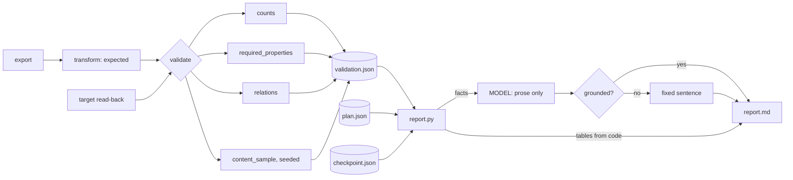

# deep-04: Validation strategy and the grounded report

Goes under `lessons/06_validation_report.py`, which runs the happy path. This lesson explains what each check catches, how to prove it, and how the report stays honest.

## Problem

All writes returned `created`. Is the customer's data right? And how do you tell the customer, in words, without a model inventing a number?

## Concept (eli5)

Think of moving house. "All boxes loaded" (counts) is not enough. You also check no box is empty (required fields),
that the lamp is still next to its plug (relations), and you open a few boxes at random (sample).
Then you write the customer a note. A helper may write the friendly lines, but you fill in every number yourself.



## Design decisions and alternatives

| Decision | Where | Why | Not picked |
|---|---|---|---|
| Compare the target with `transform()` output, not the raw source | `validate.py:18` | Tests what we *meant* to write; the same rules as the run | Compare raw source (mapping changes look like errors) |
| Four named checks, each with ids | `validate.py:20-28` | The customer can find each bad record | One pass/fail flag |
| Counts compare id *sets*, not just numbers | `validate.py:49-53` | A missing and an extra record cancel in a bare count | Count only |
| Read all pages in pages of 50 | `validate.py:42-46` | Works for any size; tested (`tests/test_validate.py:76`) | One huge read |
| Relation targets are fetched and must exist | `validate.py:61-68` | A dangling link is silent data loss | Trust the store |
| Seeded `random.Random(seed).sample` | `validate.py:70` | Same sample on every run (D-010) | Unseeded sample |
| `warn` for people | `validate.py:32-37` | No read tool for people: say so, do not fake a pass | Skip silently |
| Report numbers from files | `report.py:49-55` | Facts have one source | Model writes tables |
| Grounding filter on prose | `report.py:29-33`, `:45-48` | Drops invented numbers and ids | Trust the model; ask it to self-check |
| `--no-llm` path | `report.py:36-37`, `:35` | Works offline; fixed summary | Mandatory model |

## Code walkthrough

**Setup.** `validate()` checks `sample_size` and `seed` are ints (`validate.py:15`), reads the schema, and calls `transform()` (`:17-18`).
`checks` is a dict of four records, each starting at `pass` (`:20-21`). `fail()` flips one to `fail`, appends a detail and adds ids without duplicates (`:23-28`).

**Per entity.**
- `expected` = transformed records by external id (`:39`). `actual` = pages read back (`:42-47`).
- **counts** (`:48-53`): `difference = count - len(expected)`; fail if the number differs *or* the id sets differ. The detail reads like
  `comment: expected 2, found 1, difference -1` and `ids` holds the symmetric difference (`:51`).
- **required_properties** (`:59-60`): a required property that is empty on a stored page.
- **relations** (`:61-68`): if the transform expected a link and the page has none, fail; for each stored link, `get_page` on the related database must find it.
  This is one call per link, so it is slow for very large data (N+1 reads, UNVERIFIED at scale).

**Content sample.** All expected records go in `candidates` (`:69`). A seeded sample is drawn (`:70`). Each sampled record is read with `get_page` and compared field by field,
`values` and `relations`, to what the transform produced (`:71-80`). A changed title shows up as `changed Title` with the record id.

**Why the damage tests matter.** `tests/test_validate.py:49` damages a migrated target four ways with raw SQL (delete a page, change a title, empty a relation, null a required value)
and asserts the *right* check fails and names the record. A validator that never fails is worth nothing; this test proves it can.

**Report.** `report()` loads `plan.json`, `checkpoint.json`, `validation.json` and shape-checks them (`report.py:17-27`).
`evidence` is the JSON text of all three; `numbers` is every numeric token in it (`:28-29`). `grounded(text)` is true when the text's numeric tokens are a subset (`:31-33`).
If the model is used, each paragraph of its reply is kept only if `grounded(p)` and it has no hyphenated id-like token (`:45-48`), else replaced with the fixed sentence (`:12`).
Then code writes the other sections: moved counts (`:49-50`), field decisions and answered questions (`:51-53`), checks with ids (`:54-55`),
and "What did not move" from source warnings (`:56`, `:61`). The next step text depends on whether any check is not `pass` (`:57-59`).

## Run it

```powershell
.venv/Scripts/python.exe lessons/06_validation_report.py --fake
```
Expected: `Validation: all checks pass; report saved` then the report text (from `lessons/README.md`).

```powershell
.venv/Scripts/python.exe -m pytest tests/test_validate.py tests/test_report.py -q -p no:cacheprovider
```
Expected: `11 passed` (6 + 5, MEASURED per-file counts).

Measured demo output (2026-11-02, `migration_agent.cli demo`): 1 board, 2 cards, 3 checklist items, 2 comments created;
`counts`, `required_properties`, `relations`, `content_sample` all PASS; one source warning (`member-missing`).

## Break it

1. In `validate.py:79` change `!=` to `==`. Now correct pages are reported as changed and damaged ones pass. `test_clean_migration_and_seeded_sample` (`tests/test_validate.py:26`) and the title case of `test_detects_damaged_target` (`:49`) should fail. (Predicted, not executed.)
2. In `report.py:46` remove `grounded(p) and`. The `Moved 99999 records.` case in `test_unsupported_claim_uses_template` (`tests/test_report.py:52`) should fail.
3. Run validation with `sample_size=0`. Counts, required and relations still run; `content_sample` passes with an empty sample. Read the saved `sample_size` field: it is `0`, so the report shows the sample proved nothing. Lesson: a pass can be a weak pass; always print how big the sample was (`validate.py:83`).

## Limits to say out loud (UNVERIFIED beyond the code)

1. The numeric filter is token-level. "5 tasks failed" passes if `5` appears anywhere in the facts (for example as a batch size). It stops inventions, not misuse.
2. The id filter is a regex for hyphenated words (`report.py:46`). It also drops innocent phrases like "built-in".
3. The sample compares what we wrote with what we read. It cannot tell that the *mapping itself* was wrong (a field mapped to the wrong property). That is the human's job at sign-off.
4. People are not read back (`validate.py:36`). The target has no read tool for them.
5. `validate` reports; it does not repair. Fixing is a decision for the human and a re-run (idempotent).

## Quiz

1. Why do counts compare sets of ids? *One missing plus one extra gives the right count but the wrong data.*
2. Why seed the sample? *So the check is reproducible and the customer can re-run it.*
3. The model writes "We moved 1,000 records." The facts say 7. What happens? *The numeric token is not in the evidence, so the paragraph is replaced with the fixed sentence.*

## Interview angle

"How do you prove a migration is correct?" Layers: counts by id set, required fields, referential integrity, seeded content sample against the transformed expectation,
plus a human-read dry run and sign-off for mapping meaning. Then: "I would raise the sample size for high-value tables and add per-field checksums for large text."
